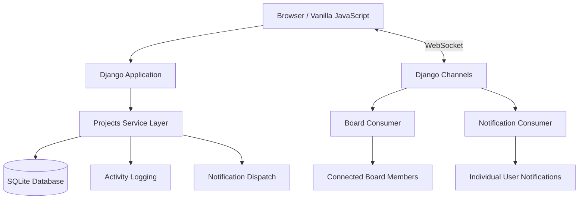

# FLOWBOARD — Collaborative Project Management Tool

<div align="center">

**Plan Together. Work Smarter. Stay in Sync.**

A modern, minimal, real-time collaborative project management platform built around Kanban workflows, team coordination, and seamless synchronization.

**CodeAlpha Full Stack Development Internship · Task 3**

<br/>


[Features](#-key-features) · [Architecture](#-architecture) · [Tech Stack](#-technology-stack) · [Installation](#-installation--setup) · [Demo](#-demo-credentials) · [Testing](#-automated-testing)

</div>

---

## Overview

**Flowboard** is a full-stack collaborative project management platform developed as **Task 3 of the CodeAlpha Full Stack Development Internship**.

Inspired by modern project management tools such as Trello, Asana, and Kanban-based workflow systems, Flowboard helps teams organize projects, manage tasks, assign responsibilities, and collaborate in real time.

Built with **Python, Django, Django Channels, SQLite, and Vanilla JavaScript**, the platform combines a structured backend architecture with a responsive, minimal interface.

Its real-time collaboration system uses WebSockets to synchronize board activities, display active collaborators, and deliver notifications without requiring page reloads.

**Core philosophy:** A focused workspace where every interaction is meaningful, every update is synchronized, and every control works as expected.

---

## Key Features

### 1. Authentication & User Profiles

- User registration, login, and logout.
- Login using username or email.
- Profile management with display name and initials-based avatar fallback.
- Instant light and dark theme switching.
- Inline field-level form validation.

### 2. Project Management

- Create, edit, and delete projects.
- Project ownership and role-based access control.
- Custom project descriptions and color tags.
- Invite team members using usernames or email addresses.
- Assign project roles: Owner and Member.
- Owner-controlled member management.
- Members can leave projects.
- Project membership verification across application endpoints.

### 3. Interactive Kanban Boards

Manage workflows through customizable Kanban boards.

**Default workflow columns:**

| Column | Purpose |
|---|---|
| To Do | Tasks waiting to be started |
| In Progress | Tasks currently being worked on |
| Review | Tasks awaiting review |
| Done | Completed tasks |

Additional capabilities:

- Create, rename, reorder, and delete columns.
- Create tasks directly inside board columns.
- Edit tasks using an interactive modal or drawer.
- Assign tasks to team members.
- Set due dates and priority levels.
- Add custom task labels.
- Drag and drop cards between columns.
- Persist task positions in the database.
- Keyboard-accessible task movement using `Alt + Arrow Keys`.

### 4. Task Discussions & Mentions

- Chronological comments inside task detail drawers.
- Delete your own comments.
- Automatic `@username` mention detection.
- Real-time notifications when users are mentioned.
- Contextual discussions connected to individual tasks.

### 5. Activity Tracking

Maintain a chronological history of project and task activities.

The activity log records:

- Task creation and deletion.
- Task movement between columns.
- Task renaming.
- Assignment changes.
- Comment activity.
- Due date modifications.
- Other project-related updates.

### 6. Search & Filters

- Search across accessible projects and tasks.
- Filter board cards by text query.
- Filter by assigned user.
- Filter by priority.
- Filter by custom labels.
- Global search across projects and tasks.

### 7. My Tasks Dashboard

A centralized view of tasks assigned to the currently authenticated user.

Tasks are organized into:

- Overdue
- Due Today
- Upcoming 7 Days
- Later
- No Due Date

This makes it easier to track personal responsibilities across multiple projects.

### 8. Real-Time Collaboration

<badge color="success">WebSocket Powered</badge>

Flowboard uses Django Channels and WebSockets to synchronize project activities between connected collaborators.

**Live Board Synchronization**
- Real-time task creation and deletion.
- Instant task movement between columns.
- Live task edits and column modifications.
- Immediate comment broadcasting.
- Active collaborator presence indicators.
- Automatic reconnection with exponential backoff.
- Heartbeat pings to maintain connections.

**Live Notifications**
- Task assignment notifications.
- Comment mention notifications.
- Project invitation notifications.
- Real-time notification badge updates.
- Toast notifications for incoming events.

### 9. Notification System

- Dedicated notification interface.
- Real-time notification delivery.
- Unread notification count.
- Notification dropdown and full notification list.
- Mark notifications as read.
- Per-user notification WebSocket connections.

### 10. Security & Access Control

- Login protection across application routes.
- Project membership validation.
- Role-based project permissions.
- Owner-only project management operations.
- CSRF validation on POST requests.
- WebSocket connection authorization.
- Custom 403, 404, and 500 error pages.
- Server-side validation for sensitive operations.

### 11. Responsive & Interactive Interface

- Minimal, content-first SaaS design.
- Light and dark color themes.
- Responsive navigation and sidebar.
- Interactive modals and drawers.
- Drag-and-drop task management.
- Toast notifications and loading feedback.
- Keyboard-accessible interactions.
- Functional controls throughout the application.

---

## Technology Stack

| Layer | Technologies |
|---|---|
| Backend | Python 3.13, Django 5.1 |
| Real-Time Communication | Django Channels 4.3, WebSockets |
| ASGI Server | Daphne 4.2 |
| Database | SQLite with WAL mode |
| Frontend | HTML5, CSS3, Vanilla JavaScript |
| Templates | Django Template Engine |
| Asynchronous Requests | JavaScript Fetch API, JSON |
| Browser Communication | WebSocket API |
| End-to-End Testing | Playwright |
| Test Automation | Python |

### Architectural Decisions

**Django Channels:** Enables asynchronous WebSocket communication for live board updates, user presence, and notifications.

**Transactional Service Layer:** `projects/services.py` centralizes database mutations, activity logging, notification dispatch, and event broadcasting.

**SQLite WAL Mode:** Uses Write-Ahead Logging to improve database read/write concurrency.

**In-Memory Channel Layer:** Uses Django Channels' `InMemoryChannelLayer`, eliminating the need for Redis or an external message broker in the configured local setup.

**Vanilla JavaScript:** Keeps the frontend lightweight without depending on React, Vue, or external animation libraries.

---

## Project Architecture

```text
flowboard/
│
├── manage.py
├── requirements.txt
├── README.md
├── LICENSE
├── UI_CHECKLIST.md
├── test_e2e.py
│
├── flowboard/
│   ├── settings.py
│   ├── asgi.py
│   ├── wsgi.py
│   ├── routing.py
│   └── urls.py
│
├── accounts/
│   ├── models.py
│   ├── views.py
│   └── forms.py
│
├── projects/
│   ├── models.py
│   ├── services.py
│   ├── consumers.py
│   ├── views.py
│   └── management/
│       └── commands/
│           └── seed_demo.py
│
├── notifications/
│   ├── models.py
│   ├── consumers.py
│   └── views.py
│
├── core/
│   ├── views.py
│   └── context_processors.py
│
├── static/
│   ├── css/
│   │   ├── tokens.css
│   │   └── style.css
│   │
│   └── js/
│       ├── app.js
│       ├── websocket.js
│       ├── dragdrop.js
│       ├── board.js
│       └── notifications.js
│
└── templates/
    ├── base.html
    ├── 403.html
    ├── 404.html
    ├── 500.html
    ├── accounts/
    ├── core/
    ├── projects/
    └── notifications/
```

### Core Django Applications

| Application | Responsibility |
|---|---|
| `accounts` | Authentication and profile management |
| `projects` | Projects, Kanban boards, tasks, comments, and activity |
| `notifications` | Notification management and real-time delivery |
| `core` | Landing page, search, and shared application views |
| `flowboard` | Main configuration, URL routing, and ASGI setup |

---

## System Architecture

Flowboard uses HTTP APIs for regular application operations and WebSockets for real-time communication.



### WebSocket Endpoints

| Endpoint | Purpose |
|---|---|
| `ws/board/<project_id>/` | Live board synchronization and presence |
| `ws/notifications/` | Per-user real-time notifications |

---

## Installation & Setup

Follow these instructions to run Flowboard locally.

### Prerequisites

- Python 3.10 or higher (Python 3.13 recommended).
- Git.
- pip.

### 1. Clone the Repository

```bash
git clone https://github.com/<your-username>/<your-repository>.git
cd <your-repository>
```

### 2. Create a Virtual Environment

**Windows (PowerShell):**

```powershell
python -m venv .venv
.\.venv\Scripts\Activate.ps1
```

**macOS / Linux:**

```bash
python3 -m venv .venv
source .venv/bin/activate
```

### 3. Install Dependencies

```bash
pip install -r requirements.txt
```

### 4. Apply Database Migrations

```bash
python manage.py migrate
```

### 5. Generate Demo Data

```bash
python manage.py seed_demo
```

The command provisions 5 demo users, 2 sample projects, and 22+ tasks.

### 6. Start the ASGI Server

**Option A — Run using Daphne:**

```bash
daphne -b 127.0.0.1 -p 8000 flowboard.asgi:application
```

**Option B — Run using Django:**

```bash
python manage.py runserver 8000
```

Open your browser:

**http://127.0.0.1:8000/**

---

## Demo Credentials

All seeded accounts use the following demo password:

`password123`

| Username | Name | Role |
|---|---|---|
| `alex` | Alex Chen | Team Lead & Product |
| `sarah` | Sarah Miller | Senior Backend Engineer |
| `elena` | Elena Rostova | Frontend & UI Specialist |
| `marcus` | Marcus Vance | Systems & Cloud Architect |
| `priya` | Priya Sharma | QA & Release Engineer |

**Note:** These credentials are intended only for local demonstration. Do not use them for a public production deployment.

---

## Testing Real-Time Collaboration

One of Flowboard's key capabilities is live collaboration between multiple users.

Follow these steps to experience it:

**Step 1 — Open the first browser window**

- Start Flowboard.
- Log in using `alex`.
- Open the project board named `Acme Mobile App v2.0`.

**Step 2 — Open a second browser window**

- Use an incognito window or a different browser.
- Log in using `sarah`.
- Navigate to the same project board.

**Step 3 — Test live synchronization**

| Action | Expected Result |
|---|---|
| Open the same board | Both users appear in live presence indicators |
| Move a task card | The other browser updates the card position |
| Add a comment | The comment appears in the other browser |
| Mention `@alex` | Alex receives a real-time notification |
| Create a new card | The card appears in both browser windows |

All synchronization takes place without requiring a full-page reload.

---

## Automated Testing

Flowboard includes a Playwright-based end-to-end test suite.

### Install Playwright Chromium

```bash
python -m playwright install chromium
```

### Run the E2E Test Suite

```bash
python test_e2e.py
```

### Test Coverage

The automated test harness verifies the interactive UI checklist and application workflows across browser sessions.

**Reported test result:**

```text
============================================================
SUCCESS: 100% of UI checklist verified
with 0 failures and 0 console errors!
============================================================
```

<badge color="success">15/15 E2E checks passing</badge>

---

## Engineering Highlights

**Real-Time Architecture:** WebSocket communication enables synchronized board activities and notification delivery.

**Transactional Operations:** A centralized service layer coordinates database mutations, activity logs, and event dispatch.

**Role-Based Access Control:** Project owners and members have different permissions enforced by the backend.

**Presence Tracking:** Connected collaborators are represented through live board presence indicators.

**Resilient Connections:** WebSocket clients implement reconnection with exponential backoff and heartbeat pings.

**Automated Verification:** Playwright tests validate interactive workflows across browser sessions.

**Zero Dead UI:** The project includes a dedicated `UI_CHECKLIST.md` to track interactive controls and their functionality.

---

## Future Improvements

Potential enhancements for future versions:

- Redis-backed channel layer for multi-process and production deployments.
- Advanced project analytics and reporting.
- File attachments for tasks.
- More granular project permissions.
- Email-based notification delivery.
- Extended automated load and concurrency testing.

---

## Internship Information

| Detail | Information |
|---|---|
| Organization | **CodeAlpha** |
| Internship | Full Stack Development |
| Task | **Task 3 — Project Management Tool** |
| Project | **Flowboard** |
| Backend | Django 5.1 |
| Real-Time Layer | Django Channels 4.3 |
| Frontend | HTML5, CSS3, Vanilla JavaScript |
| Database | SQLite |

---

## License

This project is licensed under the **MIT License**. See the [`LICENSE`](LICENSE) file for details.

---

<div align="center">

# FLOWBOARD

**Organize Work. Connect Teams. Move Forward.**

Built as part of the **CodeAlpha Full Stack Development Internship — Task 3**.

</div>
